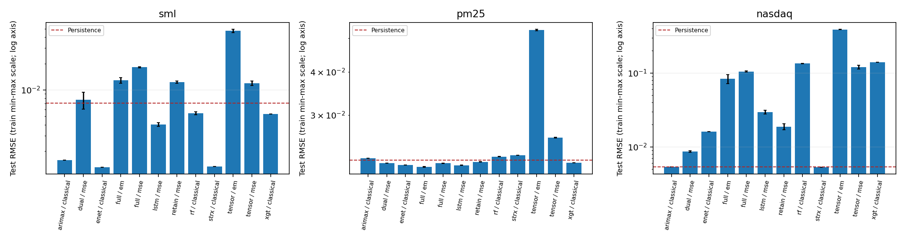
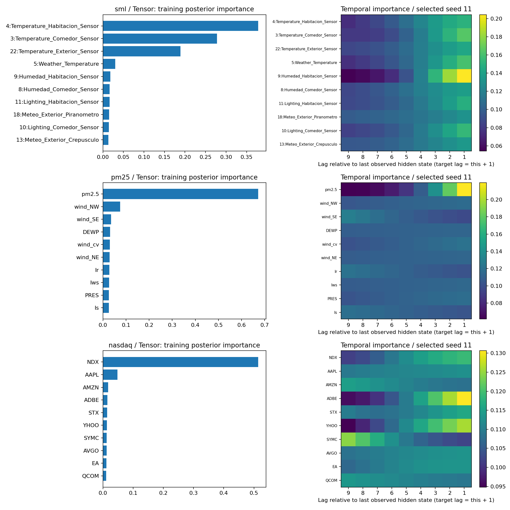

# IMV-LSTM 论文复现实验报告

> 这是基于真实运行与独立checkpoint核验的最终实验报告。对象：Guo, Lin & Antulov-Fantulin, *Exploring Interpretable LSTM Neural Networks over Multi-Variable Data*, ICML 2019。完成范围是三套公开数据上的方法、基线和解释实验；PLANT原始快照未取得，不能称为四数据集逐项数值完全复现。表格内“100%”若出现仅指预登记公开数据计划完成率，绝不表示达到论文全部数值。

## 1. 主要实验发现及其含义

三套公开数据的预登记实验及严格核验均已完成，但**未重现论文的普遍性能优势**。Full仅在PM2.5上较persistence改善约4.53%；Tensor在三套数据上均明显落后。本次结果不能写成“论文所有主要结论均得到验证”。

- **sml / IMV-tensor**：原单位RMSE均值 0.825926，persistence为 0.123585，相对改善 -568.31%；本协议下差于或持平上一观测值基线。5次重复的每一个结果均保留，没有筛去差seed。
- **sml / IMV-full**：原单位RMSE均值 0.225127，persistence为 0.123585，相对改善 -82.16%；本协议下差于或持平上一观测值基线。5次重复的每一个结果均保留，没有筛去差seed。
- **pm25 / IMV-tensor**：原单位RMSE均值 52.5224，persistence为 22.133，相对改善 -137.30%；本协议下差于或持平上一观测值基线。5次重复的每一个结果均保留，没有筛去差seed。
- **pm25 / IMV-full**：原单位RMSE均值 21.1314，persistence为 22.133，相对改善 4.53%；本协议下优于上一观测值基线。5次重复的每一个结果均保留，没有筛去差seed。
- **nasdaq / IMV-tensor**：原单位RMSE均值 101.922，persistence为 1.41421，相对改善 -7106.98%；本协议下差于或持平上一观测值基线。5次重复的每一个结果均保留，没有筛去差seed。
- **nasdaq / IMV-full**：原单位RMSE均值 22.0027，persistence为 1.41421，相对改善 -1455.83%；本协议下差于或持平上一观测值基线。5次重复的每一个结果均保留，没有筛去差seed。

- **sml 全模型比较**：本协议均值最低的是 enet/classical，RMSE=0.0229194；这是测试汇总后的描述，未据此回头更改训练或搜索。
  tensor：EM相对相同结构MSE的RMSE改善 -296.95%（正数为EM更好），EM=0.825926、MSE=0.208066。
  full：EM相对相同结构MSE的RMSE改善 29.06%（正数为EM更好），EM=0.225127、MSE=0.317369。
- **pm25 全模型比较**：本协议均值最低的是 full/em，RMSE=21.1314；这是测试汇总后的描述，未据此回头更改训练或搜索。
  tensor：EM相对相同结构MSE的RMSE改善 -104.46%（正数为EM更好），EM=52.5224、MSE=25.6887。
  full：EM相对相同结构MSE的RMSE改善 2.42%（正数为EM更好），EM=21.1314、MSE=21.6554。
- **nasdaq 全模型比较**：本协议均值最低的是 strx/classical，RMSE=1.39439；这是测试汇总后的描述，未据此回头更改训练或搜索。
  tensor：EM相对相同结构MSE的RMSE改善 -221.63%（正数为EM更好），EM=101.922、MSE=31.6887。
  full：EM相对相同结构MSE的RMSE改善 19.98%（正数为EM更好），EM=22.0027、MSE=27.4981。

这些比较检验“变量级hidden + mixture attention能否提高当前公开数据协议下的一步预测”。必须同时看简单persistence、LSTM、DUAL、RETAIN、传统机器学习和不同seed的波动。单个最优seed或单个数据集不足以证明整体优势；预测优势也不意味着注意力给出因果关系。若某模型不优于基线，这是有效的负结果，未通过改测试划分、使用未来数据或挑seed来美化。

## 2. 交付内容与证据边界

- `summary_metrics.csv`：全变量/变量选择各模型的均值、样本SD和SE；`seed_metrics.csv`保留每个固定seed、超参、最优epoch和参数量。
- `variable_selection.csv`：top50%重训结果；`uncertainty.csv`：与persistence误差差异的时间block-bootstrap区间。
- `interpretation_stability.csv`：5seed训练重要性排名一致性；`data_audit.csv`：实际有效样本数；`paper_comparison.csv`：论文与本次口径并列。
- 两张概括图分别展示预测误差和Tensor代表seed的重要性/时间分布。误差图采用对数纵轴、虚线标出persistence，误差棒是seed均值SE（不是完整泛化置信区间）。代表图固定使用seed11，不根据测试结果选图；所有seed的统计在CSV中。
- 原始数据、所有训练checkpoint/优化器状态、完整逐epoch日志、逐点预测、搜索尝试、独立验证记录和Linux锁依赖都留autoDL。汇总包只包含足以理解结果的文件。

## 3. 论文核心方法如何实现

### 3.1 Full与Tensor的区别

每个变量拥有d维hidden，整体D=N*d。候选更新j_t采用变量独立的input/recurrent映射。IMV-Full的i/f/o门读取所有变量输入和hidden，门可以建模跨变量影响；因此Full不应被描述为完全无跨变量信息。IMV-Tensor的候选、门和memory全部按变量独立更新，最后用mixture attention汇合。对Tensor有扰动独立性测试，对两者有未来输入不影响之前hidden的时序测试。

### 3.2 两级注意力和概率混合

先对每变量前T-1个hidden做归一化时间attention，得到context，再与最后hidden拼接。每变量有独立均值与方差头；变量打分函数共享，softmax为先验pi。混合分布p(y|X)=sum_n pi_n*N(y;mu_n,sigma_n²)。预测严格使用sum(pi*mu)，推断没有使用真实未来y。sigma采用softplus+0.001（训练minmax尺度）的数值下界，防止高斯分量方差塌缩；该数值下界是明确登记的实现选择。

### 3.3 EM、后验重要性与MSE消融

训练E步q_n=softmax(log pi_n+log Gaussian(y;mu_n,sigma_n))，q被冻结后对-logjoint的q加权期望做梯度下降。根据论文式11，I=训练实例q平均；式12的时间重要性为训练alpha平均。式9第三项在E步q固定时只决定全局I的闭式更新，不应凭空额外向theta传梯度。自动测试验证EM与直接混合NLL的梯度一致，以及手算高斯后验数值。

逐epoch重要性轨迹是该epoch在线训练batch的q平均，参数会随batch更新；最终I/T则在**验证集选中的最佳checkpoint、eval模式、完整训练集**上重新准确汇总。两者用途不同。beta/先验均值单独保存，绝不把beta冒称后验I。MSE版本只使用相同结构的点预测MSE，sigma不由MSE训练，因此不对其导出伪高斯后验；MSE的排名是attention，不是式11。

### 3.4 基线实现与适用限制

LSTM是普通单层LSTM回归；DUAL实现input-attention encoder及temporal-attention decoder，decoder另接过去已观测目标，encoder排除目标列；RETAIN用reverse-time双GRU产生时间与embedding维attention后做回归，变量排名取绝对预测贡献。两者是本文从原方法结构独立编写的回归适配，不能冒称原作者基线二进制的完全相同行为。

RF/XGT/ENET把整个过去窗口展平；STRX为有外生回归的local linear trend状态空间；ARIMAX阶数(p,d,q)=(T,0,T)，使用最后已观测时刻的外生变量，预测逐步吸收此前已出现的真实观测。统计模型在有效窗口缺口保持原始时间网格，缺y不回填，缺口exog只用训练均值填充；常数/共线exog仅以训练矩阵QR剔除。统计初次优化先100迭代、未收敛则继续300迭代。失败项保留原始目录，额外训练集数值诊断使用QR预条件和不同求解器；候选必须同时满足优化器收敛、有限归一化优化坐标score最大值≤1e-6、训练似然重放一致、QR预测映射及未来标签隔离检查。修复在独立sidecar目录，登记来源后由验证器和报告统一解析，不覆盖原失败。ARIMAX如采用exact diffuse初始化，属于明确披露的初始化变体，不能称与原approximate diffuse目标完全相同。所有测试预测用原尺度参数和训练固定方差的未剖面化模型过滤，测试数据不估计方差。

本次在实验后对六个状态空间组统一升级了数值验收，不能称为预登记标准。原SML STRX、NASDAQ STRX/ARIMAX虽然有优化器成功flag，在统一QR/logvariance/创新SD坐标下重算的最大归一化score分别约0.04863、0.003285、0.05752，因此另行训练集续优化；这不证明原预测必然错误。原SML ARIMAX与PM STRX未收敛、PM ARIMAX发生非有限数值，均保留原证据。六组最终均以物理参数独立过滤、训练似然与预测映射校验，以及当前/未来标签扰动的因果前缀检查验收。特定原成功组的替代仅由固定原证书和版本2策略授权，不能任意覆盖成功结果。

数值修复依次遇到低内存backend shape错误、profile与原approximate-diffuse训练似然不等价、梯度方向不一致及优化器precision-loss，均作为失败保留，未当成功。最终采用未剖面化似然、可逆QR、log variance和训练创新SD缩放；ARMA保持窗口对应的完整阶数，不因拟合困难降阶。最终exact-diffuse初始化是披露的变体。

PM ARIMAX最终BFGS成功且最大score约4.46e-8，但单一步长1e-5的中心差分存在二阶截断误差。固定同一物理参数后，使用预先固定的12步长网格1e-3至3e-9、三个固定方向种子11/23/47；要求三个相邻步长同时与complex-step方向导数一致（rtol=0.02、atol=2e-6），且三者极差≤2e-6。选第一个满足条件的平台，不挑单个幸运步长。六组最终统一采用同一多步长审计；score≤1e-6和边界KKT≤1e-6门槛保持不变。该认证不优化参数，也不读测试表现决定是否接受。

| group | score_max | boundary_violation | initialization | status |
| --- | --- | --- | --- | --- |
| sml_strx | 6.23672e-08 | 0 | exact_diffuse | PASS |
| sml_arimax | 2.27315e-08 | 0 | exact_diffuse | PASS |
| pm25_strx | 4.258e-09 | 0 | exact_diffuse | PASS |
| pm25_arimax | 4.46037e-08 | 0 | exact_diffuse | PASS |
| nasdaq_strx | 2.74465e-08 | 0 | exact_diffuse | PASS |
| nasdaq_arimax | 1.52484e-08 | 0 | exact_diffuse | PASS |

## 4. 数据、目标、时间切分与泄漏防护

| dataset | raw_rows | variables | window | train | val | test | dropped_windows |
| --- | --- | --- | --- | --- | --- | --- | --- |
| sml | 4137 | 17 | 10 | 3180 | 400 | 521 | 26 |
| pm25 | 43824 | 11 | 10 | 23185 | 8340 | 8359 | 3930 |
| nasdaq | 40560 | 82 | 10 | 35090 | 2730 | 2730 | 0 |

**SML2010**：公开两段T15文件共4137行；房间温度为目标，16个外生变量加目标历史共17维。按原始行3200/3600切分；窗口10，跨文件和非连续15分钟窗口不使用。正文称每分钟，但图4与文件实际为15分钟，本次遵从可核实源文件。第三方notebook的餐厅温度目标不是本次目标。

**PM2.5**：北京2010—2014逐小时数据，原始43824行。目标pm2.5；DEWP、TEMP、PRES、Iws、Is、Ir，加风向NE/NW/SE/cv四固定哑变量及目标历史，共11维。任何输入或目标缺失的整窗排除，不用未来回填。60/20/20按原始行时间切分来自已登记的公开实现协议，论文未充分指定该数据划分；论文图中只有7维而文字提风向，本次保留风向并显式披露差异。有效样本总数未必等于原文41700，不能强行修改成相同数目。

**NASDAQ**：81只股票与NDX共82维，目标NDX；40560行，原始行35100/37830为切点，窗口10。公开文件已padding，本次不再插值；没有原始逐股票时间戳，无法进一步还原作者padding之前的缺失过程。

**PLANT**：没有取得可确认对应20842序列及9天气变量的原始数据快照。原作者config列的是本地dat路径，推荐PyTorch仓库也未发布它。已查看作者仓库、原研究作者托管论文和大学记录，未将其他光伏数据替代。本项未完成，是全论文复现的明确缺口。

窗口目标为下一时点；train/val/test按目标原始行互不重叠，val/test可使用此前已观测历史（rolling one-step）。这不是在同一个起点开放式预测整个测试区间。x/y minmax只用训练窗口/训练目标拟合；常数列分母1；测试值可超出[0,1]，不会反过来扩大训练尺度。输入目标列的scale与输出y scale分别保存，persistence由输入目标列正确逆变换，避免混用边界略不同的scaler。

## 5. 训练、超参选择、重复与恢复

5个种子固定为11、23、47、71、101。Adam batch64，梯度范数上限5，模型heads dropout，L2只作用于矩阵参数，学习率恒定。训练用MSE或论文EM期望目标；**超参数和checkpoint一律根据验证RMSE**选择，不能根据测试likelihood或测试RMSE选择。

主模型每数据/结构搜索16组预登记均衡组合，覆盖d={10,15,20,25}、lr={0.0005,0.001,0.005,0.01,0.05}、dropout={0,0.2,0.5}与L2={0.0001,0.001,0.01,0.1,1}。原论文全部笛卡尔积300组/组合，本次16组是明确的资源折中，**没有做完整穷举**。深度基线6组覆盖h16/32/64/128/256/512，但没有穷举全部学习率/正则。所有搜索seed11、最多80epochs、patience20；正式重复最多150epochs、patience35。MSE消融复用EM选择的架构/训练超参，用于控制结构差异，不能解释为MSE独立最优超参。

| combination | units/lr/dropout/L2 | best_val_rmse_scaled | candidates |
| --- | --- | --- | --- |
| nasdaq_dual | [64, 0.001, 0, 0.0001] | 0.0081426 | 6 |
| nasdaq_full | [25, 0.0005, 0, 0.0001] | 0.0208323 | 16 |
| nasdaq_lstm | [64, 0.001, 0, 0.0001] | 0.0090669 | 6 |
| nasdaq_retain | [64, 0.001, 0, 0.0001] | 0.00745769 | 6 |
| nasdaq_tensor | [20, 0.0005, 0.2, 0.0001] | 0.151353 | 16 |
| pm25_dual | [64, 0.001, 0, 0.0001] | 0.0240414 | 6 |
| pm25_full | [10, 0.0005, 0, 0.0001] | 0.023924 | 16 |
| pm25_lstm | [512, 0.0005, 0, 0.0001] | 0.0236912 | 6 |
| pm25_retain | [512, 0.0005, 0, 0.0001] | 0.0244049 | 6 |
| pm25_tensor | [20, 0.0005, 0.2, 0.0001] | 0.0535573 | 16 |
| sml_dual | [256, 0.001, 0.5, 0.0001] | 0.00763635 | 6 |
| sml_full | [25, 0.001, 0.5, 0.001] | 0.00835855 | 16 |
| sml_lstm | [64, 0.001, 0, 0.0001] | 0.00378894 | 6 |
| sml_retain | [32, 0.005, 0.2, 0.001] | 0.0072485 | 6 |
| sml_tensor | [25, 0.0005, 0, 0.0001] | 0.0337657 | 16 |

RF搜索depth3/6/10和tree2/50/100/200；XGT搜索depth3/6/10、tree50/100/200及论文6种L2；ENET搜索L1/L2各8个值。RF/XGT用5个固定seed分别拟合；本协议XGT的subsample/colsample默认为1，五seed预测完全一致，SD=0反映该配置的确定性，不能当成五份独立测试误差样本或无泛化不确定性；确定性ENET/STRX/ARIMAX只真实拟合一次，不能复制5行假装独立重复。STRX/ARIMAX的最大迭代与收敛信息单独保存。

每epoch原子保存model、Adam状态、Python/NumPy/torch/CUDA随机状态、epoch、最佳验证轮次与完整历史。续跑严格检查配置、数据和模型/engine源码hash，发生变化时拒绝混合不同实现。回归测试验证“连续3epoch”与“1epoch中断后恢复到3epoch”权重逐元素完全一致。长任务独立后台进程运行，SSH断连不会杀死训练；同一suite有文件锁防止重复启动。GPU计算有其他任务时等待，仅使用已有2080Ti，不购买算力。

## 6. 主要预测结果

原单位RMSE/MAE和训练minmax尺度分别给出。SD是5seed样本标准差(ddof=1)，SE=SD/sqrt(5)；确定性单次拟合的SD/SE在CSV记0，表示未测量训练随机性，而不是已证明无不确定性。不能把SE当作时间序列泛化误差的完整置信区间。

| dataset | model | objective | n_runs | rmse_raw_mean | rmse_raw_se | mae_raw_mean | rmse_scaled_mean | all_runs_completed |
| --- | --- | --- | --- | --- | --- | --- | --- | --- |
| nasdaq | arimax | classical | 1 | 1.39917 | 0 | 0.888773 | 0.00533328 | True |
| nasdaq | dual | mse | 5 | 2.26863 | 0.0616891 | 1.67983 | 0.00864743 | True |
| nasdaq | enet | classical | 1 | 4.19894 | 0 | 3.52262 | 0.0160051 | True |
| nasdaq | full | em | 5 | 22.0027 | 3.06071 | 20.8638 | 0.0838686 | True |
| nasdaq | full | mse | 5 | 27.4981 | 0.569894 | 26.2915 | 0.104816 | True |
| nasdaq | lstm | mse | 5 | 7.74699 | 0.433105 | 7.32354 | 0.0295296 | True |
| nasdaq | retain | mse | 5 | 4.92553 | 0.440234 | 4.24333 | 0.0187748 | True |
| nasdaq | rf | classical | 5 | 35.268 | 0.113069 | 33.0124 | 0.134433 | True |
| nasdaq | strx | classical | 1 | 1.39439 | 0 | 0.883365 | 0.00531507 | True |
| nasdaq | tensor | em | 5 | 101.922 | 0.53511 | 101.255 | 0.388499 | True |
| nasdaq | tensor | mse | 5 | 31.6887 | 1.81469 | 30.6525 | 0.120789 | True |
| nasdaq | xgt | classical | 5 | 36.7701 | 0 | 34.2843 | 0.140158 | True |
| pm25 | arimax | classical | 1 | 22.3578 | 0 | 12.1738 | 0.0224927 | True |
| pm25 | dual | mse | 5 | 21.6704 | 0.0123316 | 11.7836 | 0.0218012 | True |
| pm25 | enet | classical | 1 | 21.3955 | 0 | 11.9349 | 0.0215247 | True |
| pm25 | full | em | 5 | 21.1314 | 0.0348806 | 11.6214 | 0.021259 | True |
| pm25 | full | mse | 5 | 21.6554 | 0.0408537 | 12.2366 | 0.0217861 | True |
| pm25 | lstm | mse | 5 | 21.364 | 0.019269 | 11.9915 | 0.0214929 | True |
| pm25 | retain | mse | 5 | 21.8517 | 0.023459 | 12.3717 | 0.0219836 | True |
| pm25 | rf | classical | 5 | 22.6268 | 0.0233659 | 12.1233 | 0.0227634 | True |
| pm25 | strx | classical | 1 | 22.8057 | 0 | 12.2259 | 0.0229434 | True |
| pm25 | tensor | em | 5 | 52.5224 | 0.228767 | 37.0049 | 0.0528394 | True |
| pm25 | tensor | mse | 5 | 25.6887 | 0.0774118 | 16.2062 | 0.0258438 | True |
| pm25 | xgt | classical | 5 | 21.7421 | 0 | 12.0225 | 0.0218733 | True |
| sml | arimax | classical | 1 | 0.0276649 | 0 | 0.0177796 | 0.00158338 | True |
| sml | dual | mse | 5 | 0.135026 | 0.0295284 | 0.10523 | 0.00772814 | True |
| sml | enet | classical | 1 | 0.0229194 | 0 | 0.0166408 | 0.00131178 | True |
| sml | full | em | 5 | 0.225127 | 0.0158933 | 0.184697 | 0.012885 | True |
| sml | full | mse | 5 | 0.317369 | 0.00471658 | 0.225516 | 0.0181644 | True |
| sml | lstm | mse | 5 | 0.0704714 | 0.00346612 | 0.0547268 | 0.00403339 | True |
| sml | retain | mse | 5 | 0.21471 | 0.00658678 | 0.173914 | 0.0122888 | True |
| sml | rf | classical | 5 | 0.0949183 | 0.00365854 | 0.0659067 | 0.00543259 | True |
| sml | strx | classical | 1 | 0.0233998 | 0 | 0.0175229 | 0.00133927 | True |
| sml | tensor | em | 5 | 0.825926 | 0.0350295 | 0.672803 | 0.0472714 | True |
| sml | tensor | mse | 5 | 0.208066 | 0.0125893 | 0.168347 | 0.0119086 | True |
| sml | xgt | classical | 5 | 0.0923982 | 0 | 0.0689749 | 0.00528836 | True |

与persistence差异的额外时间不确定性使用1000次circular moving-block bootstrap，块长20个有效预测窗口，5seed误差先在同一时间点平均，再对时间块抽样。delta MSE = IMV平方误差均值 - persistence平方误差；负数表示IMV更好，95%区间跨0则证据不明确。PM缺口场景中块长按有效窗口计，不代表严格连续20小时；这是该bootstrap的局限。未做多重比较校正，不把它作为所有比较的显著性保证。

| dataset | model | delta_mse_vs_persistence | ci95_low | ci95_high | block_valid_windows | bootstrap_repeats |
| --- | --- | --- | --- | --- | --- | --- |
| sml | tensor | 0.671789 | 0.490922 | 0.903049 | 20 | 1000 |
| sml | full | 0.0364192 | 0.0221261 | 0.0537667 | 20 | 1000 |
| pm25 | tensor | 2268.94 | 1759.95 | 2856.99 | 20 | 1000 |
| pm25 | full | -43.3298 | -60.1869 | -27.8789 | 20 | 1000 |
| nasdaq | tensor | 10387.2 | 10001.7 | 10754.5 | 20 | 1000 |
| nasdaq | full | 519.589 | 477.715 | 563.737 | 20 | 1000 |

### 6.1 泛化差异、训练预算与负结果诊断

| dataset | model | target_outside_train_pct | mean_val_rmse_scaled | mean_test_rmse_scaled | mean_test_bias_raw | runs_at_epoch_cap |
| --- | --- | --- | --- | --- | --- | --- |
| sml | full | 0 | 0.00876089 | 0.012885 | -0.0537525 | 0 |
| sml | tensor | 0 | 0.0576978 | 0.0472714 | -0.0589383 | 0 |
| pm25 | full | 0 | 0.0236811 | 0.021259 | 0.087776 | 5 |
| pm25 | tensor | 0 | 0.0541504 | 0.0528394 | -1.78347 | 0 |
| nasdaq | full | 97.3993 | 0.0266942 | 0.0838686 | -20.7919 | 1 |
| nasdaq | tensor | 97.3993 | 0.1534 | 0.388499 | -101.255 | 0 |

NASDAQ测试目标约97.40%超出训练目标minmax范围（测试缩放值约0.974—1.194）。Full五seed的平均残差均为负，单seed平均偏差约-14.1至-31.3指数点；Tensor约-99.8至-102.7点。这里观察到明显的范围外外推和系统低估，支持“本协议下泛化失败存在”的结论，但不能仅凭它证明失败的唯一原因。SML和PM测试目标均在训练目标范围内，Tensor仍落后，说明目标越界不足以解释所有差距；目标范围内也不保证输入联合分布完全相同。

PM Full五seed都达到150轮预算，最佳验证轮次在140—148附近；本次没有继续增加轮数后挑更好测试结果。深度run的completed/all_runs_completed表示固定训练预算已执行并核验，**不等于神经网络梯度达到数值收敛**。不能把150轮完成与统计模型score收敛混为一谈。有限超参预算、EM似然目标与点预测RMSE的差别、正则/方差下界及数据协议都可能影响结果，当前证据不能分解它们的独立因果贡献；这也不证明论文方法在所有协议下无效。

与persistence的block-bootstrap区间中，仅PM Full的delta MSE区间完全小于0（约[-60.19,-27.88]）；其他五项完全大于0，方向与主要结果一致。这是固定块长和当前评估集下的描述性不确定性结果，不能补偿数据协议不一致或未穷举搜索。

## 7. 变量选择实验与解释证据

每模型、每seed使用该seed全变量模型的**训练集**排名选ceil(N/2)个变量，从头重训，继承全变量验证选定超参，再用新验证最优epoch。IMV按EM后验I与训练Pearson各做一组；Pearson为各变量各lag对下一步训练y的绝对相关系数之均值，常数列相关0。这个lag聚合选择是明确登记的实现细节，原文没有完全指定。DUAL按encoder attention，RETAIN按绝对贡献排名。DUAL的目标历史还提供给decoder，即使未入encoder top50%；因此它的有效输入包括额外目标历史，必须在比较时注明，不能声称所有模型信息预算严格相等。

| dataset | model | objective | selection | n_runs | rmse_raw_mean | mae_raw_mean | rmse_scaled_mean |
| --- | --- | --- | --- | --- | --- | --- | --- |
| nasdaq | dual | mse | importance | 5 | 2.56858 | 2.01649 | 0.00979076 |
| nasdaq | full | em | importance | 5 | 27.9022 | 26.9831 | 0.106356 |
| nasdaq | full | em | pearson | 5 | 16.4448 | 15.6496 | 0.0626835 |
| nasdaq | retain | mse | importance | 5 | 9.49732 | 8.52576 | 0.0362014 |
| nasdaq | tensor | em | importance | 5 | 90.7785 | 90.1343 | 0.346025 |
| nasdaq | tensor | em | pearson | 5 | 88.6709 | 88.1359 | 0.337991 |
| pm25 | dual | mse | importance | 5 | 21.719 | 11.848 | 0.0218501 |
| pm25 | full | em | importance | 5 | 31.843 | 19.5145 | 0.0320352 |
| pm25 | full | em | pearson | 5 | 21.3089 | 11.8455 | 0.0214375 |
| pm25 | retain | mse | importance | 5 | 21.8285 | 12.2683 | 0.0219602 |
| pm25 | tensor | em | importance | 5 | 38.7251 | 26.5154 | 0.0389589 |
| pm25 | tensor | em | pearson | 5 | 38.2291 | 26.455 | 0.0384598 |
| sml | dual | mse | importance | 5 | 0.13555 | 0.111156 | 0.00775813 |
| sml | full | em | importance | 5 | 0.188353 | 0.14146 | 0.0107803 |
| sml | full | em | pearson | 5 | 0.155755 | 0.115364 | 0.00891456 |
| sml | retain | mse | importance | 5 | 0.235948 | 0.193876 | 0.0135044 |
| sml | tensor | em | importance | 5 | 0.56674 | 0.470901 | 0.032437 |
| sml | tensor | em | pearson | 5 | 0.551084 | 0.465403 | 0.031541 |

- sml/tensor/importance：保留约一半变量后RMSE=0.56674，比全变量变化 -31.38%（负数为改善）。
- sml/tensor/pearson：保留约一半变量后RMSE=0.551084，比全变量变化 -33.28%（负数为改善）。
- sml/full/importance：保留约一半变量后RMSE=0.188353，比全变量变化 -16.33%（负数为改善）。
- sml/full/pearson：保留约一半变量后RMSE=0.155755，比全变量变化 -30.81%（负数为改善）。
- pm25/tensor/importance：保留约一半变量后RMSE=38.7251，比全变量变化 -26.27%（负数为改善）。
- pm25/tensor/pearson：保留约一半变量后RMSE=38.2291，比全变量变化 -27.21%（负数为改善）。
- pm25/full/importance：保留约一半变量后RMSE=31.843，比全变量变化 +50.69%（负数为改善）。
- pm25/full/pearson：保留约一半变量后RMSE=21.3089，比全变量变化 +0.84%（负数为改善）。
- nasdaq/tensor/importance：保留约一半变量后RMSE=90.7785，比全变量变化 -10.93%（负数为改善）。
- nasdaq/tensor/pearson：保留约一半变量后RMSE=88.6709，比全变量变化 -13.00%（负数为改善）。
- nasdaq/full/importance：保留约一半变量后RMSE=27.9022，比全变量变化 +26.81%（负数为改善）。
- nasdaq/full/pearson：保留约一半变量后RMSE=16.4448，比全变量变化 -25.26%（负数为改善）。

六个“数据集×IMV结构”组合中，Pearson筛选的平均RMSE全部低于后验重要性筛选；PM Full后验筛选还使RMSE从约21.13升至31.84。因此本次不支持“后验排名稳定优于简单相关筛选”的结论。Tensor筛选后虽然相对自身全变量有所改善，仍未超过persistence。

如果top50%后误差接近或更低，可支持“本协议下所选变量保留有用预测信息”的有限结论；如果更差，应承认筛选损失，不能笼统重复论文“自动得到更优结果”。Pearson的线性关联和后验的模型内分配不是同一量，负相关取绝对值也不代表负贡献被忽略。此实验不鉴定真实因果变量。

| dataset | model | mean_pairwise_spearman | top3_seed11 |
| --- | --- | --- | --- |
| sml | tensor | 0.470343 | 4:Temperature_Habitacion_Sensor, 3:Temperature_Comedor_Sensor, 22:Temperature_Exterior_Sensor |
| sml | full | 0.47451 | 4:Temperature_Habitacion_Sensor, 3:Temperature_Comedor_Sensor, 5:Weather_Temperature |
| pm25 | tensor | 0.678182 | pm2.5, wind_NW, wind_SE |
| pm25 | full | 0.247273 | DEWP, pm2.5, wind_cv |
| nasdaq | tensor | 0.662318 | NDX, AAPL, AMZN |
| nasdaq | full | -0.0172494 | NDX, VIAB, NXPI |

- sml/tensor：平均排名Spearman=0.4703；一致性有限，单seed变量解释应保守。
- sml/full：平均排名Spearman=0.4745；一致性有限，单seed变量解释应保守。
- pm25/tensor：平均排名Spearman=0.6782；有一定跨seed一致性，仍不能解释为因果。
- pm25/full：平均排名Spearman=0.2473；一致性有限，单seed变量解释应保守。
- nasdaq/tensor：平均排名Spearman=0.6623；有一定跨seed一致性，仍不能解释为因果。
- nasdaq/full：平均排名Spearman=-0.0172；一致性有限，单seed变量解释应保守。

代表Tensor图中目标自身历史（房间温度、pm2.5、NDX）排名较高，显示模型确实将后验质量分配给目标历史；然而Tensor预测仍较差，说明“解释看起来合理”不能替代预测误差验证。热图每套数据使用各自色标，不应直接跨面板按颜色深浅比较绝对差异。

Spearman为5seed两两排名相关的均值，衡量解释稳定性。高预测精度不保证跨seed排名一致；低一致性意味着对单一变量排名的解释应保守。代表性时间图展示训练alpha平均：相对最后观测hidden的lag9..1，对预测目标实际lag10..2；最后观测hidden单独直接进入输出。更集中到最近历史表示该模型在该变量上相对偏向近期状态，不等于真实物理系统只存在这一滞后。





## 8. 参数量、效率与复杂度

原论文Lemma3.1对recurrent部分的单bias参数计数为：标准LSTM 4D²+4ND+4D；Full比它少(N-1)D+(1-1/N)D²；Tensor比它少4(N-1)D+4(1-1/N)D²。N3,d2,D6的手算测试给出Full204、Tensor96、标准240。网络总参数还包括attention、均值与方差头，不能直接拿总参数套Lemma。PyTorch标准LSTM还有两套bias，其实际参数会比上述单bias公式多4D。

真实每轮耗时在各run history中，训练总耗时与参数量在seed_metrics.csv。GPU kernel、Python循环、batch、数据量和收敛epoch会改变实际运行时间，理论O(D²/N+D)并不保证端到端恰好N倍加速。不同模型选择的d/h也可能不同，因此应结合具体参数量与训练时长解释，不能只按理论阶数宣布跑得更快。状态空间sidecar的seconds主要包含相应末次优化/认证和重放，不包括全部早期失败诊断与暖启动计算，因此不能用这个字段给统计方法做端到端效率排名。

## 9. 与论文数值的对应及未达项

| dataset | model | paper_rmse | paper_mae | our_rmse_raw | our_rmse_scaled | directly_comparable | reason |
| --- | --- | --- | --- | --- | --- | --- | --- |
| pm25 | full | 24.47 | 15.23 | 21.1314 | 0.021259 | False | paper scaling and/or exact preprocessing not fully specified |
| pm25 | tensor | 24.29 | 14.87 | 52.5224 | 0.0528394 | False | paper scaling and/or exact preprocessing not fully specified |
| sml | full | 0.015 | 0.012 | 0.225127 | 0.012885 | False | paper scaling and/or exact preprocessing not fully specified |
| sml | tensor | 0.009 | 0.006 | 0.825926 | 0.0472714 | False | paper scaling and/or exact preprocessing not fully specified |
| nasdaq | full | 0.27 | 0.23 | 22.0027 | 0.0838686 | False | paper scaling and/or exact preprocessing not fully specified |
| nasdaq | tensor | 0.09 | 0.07 | 101.922 | 0.388499 | False | paper scaling and/or exact preprocessing not fully specified |

**directly_comparable=False的原因**：论文没有充分公开相同缩放/PM缺失处理/PLANT数据；SML/NASDAQ表中小数不能在口径未确认时强行当成原单位。本次双口径结果用于透明展示，不通过挑某个归一化因子让数字看起来接近。Full/Tensor方法结构、后验/时间解释、公开数据时间切分和重复比较是本次主要可验证复现内容；论文全部4数据、全超参穷举、原TensorFlow训练逐行运行与原始全部baseline实现未完全完成。

未收敛的经典模型组数：0。若大于0，相关行statistical_converged=False，结果可作求解器诊断，不能当成收敛基准。数值失败的搜索候选数：0；这些候选保留错误与配置、被排除于验证候选集合，未静默更改其超参。它们不是正式重复中的被挑除seed。

本次没有因非有限数值被排除的搜索候选。

## 10. 独立验证做了什么

所有195个正式深度run逐一重载最佳checkpoint（先在CPU完成一部分，再在空闲GPU完成余项；每行均绑定同一核验函数、模型源码、数据和artifact SHA，迁移不重训、不清空已验证证据），用与训练导出不同batch大小256独立前向，核对全部测试target_row、预测、原/缩放RMSE与MAE、best epoch是否为验证历史最小值，校验配置/数据/文件SHA。EM的训练后验I还在验证器里按logjoint重新计算，不仅信任导出的importance.csv。15组经典模型逐点预测CSV与原/缩放指标复算。pandas对float32数组导出最短十进制后默认以float64读回；验证器恢复XGT/ENET原预测float32精度、使用处理文件中canonical标签重算，核对原精度的逆变换往返，指标门槛仍为rtol1e-9/atol1e-10。对全部经典组和种子，重建后的指标与原结果差异最大约1.42e-14；没有改动已保存预测/指标或放宽验收。其参数与求解器诊断另存。

验证同时要求完整expected dataset×model×seed×selection集合存在，缺任一正式运行会失败，不能“只核验已完成部分然后称全通过”。搜索运行不允许含测试指标/预测文件；选择配置必须是公开记录验证分数的最小值。数学测试覆盖高斯后验手算、EM/NLL梯度、batch1、归一化、有限梯度、Tensor变量流隔离、因果前缀、参数量、基线与恢复一致性。验证状态：PASS，深度run 195、经典组 15。新增断点恢复、审批身份、来源变更、候选收敛与多步长认证的反例测试全部通过，最近完整科学测试为77项；最终发布前还会再次检查。

局限：模型推断核验仍加载同一模型实现，因此数学/数据对齐测试是独立补充；缺少作者原始预处理dat时，无法证明逐样本与作者内部数据一致。没有把自校验通过等同于论文数值完全相同。

## 11. 复现、资源与文件追溯

所有实验只使用用户已有autoDL实例2080Ti与独立安装的开源包；无额外付费API、数据购买、扩容或订阅修改。普通训练CPU线程2，后期统计续优化每进程1线程，GPU单worker，最多60%显存，其他GPU任务出现时等待。项目环境/数据/cache/checkpoint/原始日志完全独立，不复用其他实验文件。

来源：[正式论文与补充材料](https://proceedings.mlr.press/v97/guo19b.html)、[原作者仓库](https://github.com/weilai0980/IMV-LSTM)、[公开数据快照来源](https://github.com/KurochkinAlexey/IMV_LSTM)。固定版本、29项资产SHA与许可边界见仓库sources.lock.json和docs/SOURCE_AUDIT.md。

公开仓库： https://github.com/VictoriaSU551/DSC6013-IMV-LSTM 。原始起点commit89433d8965c8957bd66598b78a83fd06375ba6db；复现代码及实验快照发布commit：`d98b4954411c557946480da397aef265c1bbf3da`。本报告随其后文档提交发布；固定代码commit可用于来源追溯。

```bash
python -m venv venv
venv/bin/python -m pip install -r requirements-autodl.txt
venv/bin/python code/setup_project.py
venv/bin/python code/prepare_data.py
PYTHONPATH=code CUBLAS_WORKSPACE_CONFIG=:4096:8 venv/bin/python -m pytest tests -q
PYTHONPATH=code CUBLAS_WORKSPACE_CONFIG=:4096:8 venv/bin/python -m repro.suite
PYTHONPATH=code venv/bin/python -m repro.verify --deep-audit output/reproduction/deep_audit_<真实编号>.json
PYTHONPATH=code venv/bin/python -m repro.report
```

上面是基础训练命令；本次严格统计恢复的实际命令、证书和版本化sidecar流程见仓库docs/REPAIR_NEXT.md与RUNNING_AUTODL.md。固定审批证书只适用于本次原始结果身份；全新数据/运行必须独立生成审计证据与新版本策略，不允许直接改证书或复用旧审批来绕过验收。未下载原始数据时先按来源审计文档取得公开数据并核对SHA。GPU版torch安装应使用匹配驱动的官方wheel；本次Linux完整freeze另保留在远端。不同CUDA/PyTorch/CPU架构即使固定seed也未必逐bit相同，因此以科学指标和公差核验为准。续跑同一结果目录不会覆盖已有证据；实现变更必须新建run集合并在执行记录说明。

## 12. 可以与不可以从本次结果得出的结论

可以评价本次公开数据协议下Full/Tensor与persistence、LSTM、DUAL、RETAIN及传统方法的一步预测误差；可以检查5seed稳定性、后验与先验差异、时间attention形态以及top50%变量保留效果；可以复算已交付指标并在远端重载模型。结论的适用对象是这些特定目标、时间划分和超参预算。

不能从本次结果保证其他市场/年份/任务的优势，不能把后验/注意力解释成因果，不能声称取得未发布的PLANT快照，不能说16组搜索等于300组穷举，不能以口径不明的论文数字给本次原单位误差贴“完全一致”的标签。结果若不支持原论文某一优势，应在主要发现中如实承认，这是严谨复现的一部分。
